# คู่มือระบบจองคอร์ท Srichaphan Tennis Academy

ระบบจองคอร์ทเทนนิสของ **Srichaphan Tennis Academy** — **5 คอร์ท (C1–C5)** เปิด **06:00–23:00 ทุกวัน** จองเป็น **รายชั่วโมง**
ผู้ใช้แต่ละเลเวลเห็นตารางและจองล่วงหน้าได้ไม่เท่ากัน

| เลเวล | ดูตาราง + จองล่วงหน้า | จองได้สูงสุด/วัน | จองค้างได้ | ต้องยกเลิกก่อนเล่น | สิทธิ์พิเศษ |
|---|---|---|---|---|---|
| 👑 **แอดมิน** (`admin`) | 30 วัน | ไม่จำกัด | ไม่จำกัด | ยกเลิกได้ตลอด | จองให้คนอื่น · ปิดคอร์ท · ยกเลิกของทุกคน · จัดการผู้ใช้ |
| 🟢 **สมาชิก** (`member`) | **14 วัน** | 2 ชม. | 4 รายการ | 3 ชม. | — |
| 🔵 **ผู้เล่นทั่วไป** (`user`) | **7 วัน** | 1 ชม. | 2 รายการ | 6 ชม. | — |
| ⚪ ยังไม่ล็อกอิน | 7 วัน (ดูอย่างเดียว) | — | — | — | — |

> "ล่วงหน้า 14 วัน" = เห็นวันนี้ + อีก 14 วัน (รวม 15 วันในแถบเลือกวัน)
> ตัวเลขทุกช่องในตารางนี้ **แก้ได้เองในแท็บ Roles ของ Google Sheet** มีผลทันที (ดูส่วนที่ 4)

**สารบัญ**

1. [ระบบทำงานยังไง](#1-ระบบทำงานยังไง)
2. [ติดตั้งครั้งแรก (เจ้าของระบบ)](#2-ติดตั้งครั้งแรก-เจ้าของระบบ) — ทำครั้งเดียว ~20 นาที
3. [ตั้งแอดมินและเลเวลผู้ใช้](#3-ตั้งแอดมินและเลเวลผู้ใช้)
4. [ปรับสิทธิ์แต่ละเลเวล (แท็บ Roles)](#4-ปรับสิทธิ์แต่ละเลเวล-แท็บ-roles)
5. [คู่มือผู้เล่น](#5-คู่มือผู้เล่น) — ส่งต่อให้ผู้เล่นได้เลย
6. [คู่มือแอดมิน](#6-คู่มือแอดมิน) — งานประจำวันของทีมงาน
7. [แก้ค่าในโค้ด และการ deploy เวอร์ชันใหม่](#7-แก้ค่าในโค้ด-และการ-deploy-เวอร์ชันใหม่)
8. [เช็คลิสต์ก่อนเปิดใช้จริง](#8-เช็คลิสต์ก่อนเปิดใช้จริง)
9. [ถ้าเจอปัญหา](#9-ถ้าเจอปัญหา)
10. [ภาคผนวก: คอลัมน์ในชีท](#10-ภาคผนวก-คอลัมน์ในชีท)

---

## 1. ระบบทำงานยังไง

```
 ผู้เล่น (มือถือ/คอม)                 Google (ฟรี)
┌──────────────────┐   ขอดูตาราง/จอง  ┌───────────────────────┐   อ่าน/เขียน  ┌──────────────────┐
│  booking.html    │ ───────────────▶ │ Apps Script Web App   │ ────────────▶ │ Google Sheet     │
│  (หน้าเว็บจอง)    │ ◀─────────────── │ WOOPS_Court_Booking.gs│ ◀──────────── │ Users / Bookings │
└──────────────────┘   ผลลัพธ์ (JSON)  │ ตรวจสิทธิ์ทุกครั้ง      │               │ / Roles          │
                                     └───────────────────────┘               └──────────────────┘
```

| ส่วน | ไฟล์ | อยู่ที่ไหน |
|---|---|---|
| หน้าเว็บจอง | `booking.html` | เว็บ woops.socialclub (repo `woops.socialclub`) |
| ระบบหลังบ้าน | `apps-script/WOOPS_Court_Booking.gs` | Apps Script ที่ผูกกับ Google Sheet |
| ฐานข้อมูล | Google Sheet แท็บ **Users**, **Bookings**, **Roles** | Google Drive ของเจ้าของระบบ |

สิ่งที่ควรรู้

- **กฎทุกข้อตรวจที่หลังบ้าน** (จองล่วงหน้ากี่วัน, กี่ชั่วโมงต่อวัน ฯลฯ) — ต่อให้มีคนแก้หน้าเว็บในเครื่องตัวเองก็โกงสิทธิ์ไม่ได้
  ผู้เล่นทั่วไปขอดูตารางวันที่ 8 ขึ้นไปก็จะถูกปฏิเสธ ไม่ใช่แค่ซ่อนปุ่ม
- **กันจองชนกัน** — ถ้าสองคนกดจองช่องเดียวกันพร้อมกัน คนแรกได้ คนที่สองได้ข้อความ "มีคนจองไปแล้ว"
- **ไม่ลบข้อมูล** — ยกเลิกการจองแล้วแถวยังอยู่ในชีท แค่เปลี่ยนสถานะเป็น `cancelled` ย้อนดูได้เสมอ
- **โหมดทดลอง** — ถ้ายังไม่ต่อหลังบ้าน หน้าเว็บจะขึ้นแถบเหลือง "โหมดทดลอง" ข้อมูลเก็บใน browser เครื่องนั้นเท่านั้น
  ใช้ลองกดเล่นได้ (แอดมิน `0800000001 / admin123` · สมาชิก `0800000002 / member123` · ทั่วไป `0800000003 / user123`)

---

## 2. ติดตั้งครั้งแรก (เจ้าของระบบ)

**ต้องมี:** บัญชี Google ที่จะเป็นเจ้าของข้อมูล (แนะนำบัญชีของสโมสร ไม่ใช่บัญชีส่วนตัวของทีมงานคนใดคนหนึ่ง)
และสิทธิ์แก้ไฟล์ใน repo `woops.socialclub` บน GitHub (ที่เก็บหน้าเว็บจอง)

### ขั้นที่ 1 — สร้าง Google Sheet

1. ล็อกอิน Google ด้วยบัญชีเจ้าของระบบ → เปิด [sheets.new](https://sheets.new)
2. ตั้งชื่อชีท (มุมซ้ายบน "Untitled spreadsheet") เป็น **Srichaphan Court Booking**
3. ไม่ต้องพิมพ์อะไรในชีท ปล่อยว่างไว้ — สคริปต์จะสร้างแท็บให้เอง

### ขั้นที่ 2 — วางโค้ด Apps Script

1. ในชีท กดเมนู **Extensions (ส่วนขยาย) → Apps Script**
   จะเปิดแท็บใหม่ เป็นหน้าเขียนโค้ด มีไฟล์ `Code.gs` ที่มี `function myFunction() {}` อยู่
2. คลิกในช่องโค้ด → **Ctrl+A** (Mac: Cmd+A) → **Delete** ให้ว่างเปล่า
3. เปิดไฟล์ `apps-script/WOOPS_Court_Booking.gs` → ก๊อปทั้งไฟล์ → วางลงไป
4. ตั้งชื่อโปรเจกต์ (มุมซ้ายบน "Untitled project") เป็น **Srichaphan Court Booking**
5. กด **Ctrl+S** (หรือไอคอนแผ่นดิสก์ 💾) เพื่อบันทึก

### ขั้นที่ 3 — รัน `setup` (สร้างแท็บในชีท)

1. ที่แถบด้านบน ข้างปุ่ม **▶ Run** มีดรอปดาวน์ชื่อฟังก์ชัน → เลือก **`setup`**
   ⚠️ ต้องเป็น `setup` เท่านั้น ฟังก์ชันอื่นเป็นตัวช่วย รันเดี่ยว ๆ จะ error
2. กด **▶ Run**
3. ครั้งแรกจะขึ้นหน้าต่าง **Authorization required** → กด **Review permissions**
4. เลือกบัญชี Google ของคุณ
5. จะเจอหน้า **"Google hasn't verified this app"** (หน้าตาน่ากลัว แต่ปกติ)
   → กด **Advanced** (ข้อความเล็ก ๆ ด้านล่างซ้าย)
   → กด **Go to Srichaphan Court Booking (unsafe)**
   ❗ ปลอดภัย เพราะเป็นสคริปต์ของคุณเองที่เพิ่งวางเข้าไป Google แค่ยังไม่ได้ตรวจเพราะไม่ได้เผยแพร่สาธารณะ
6. หน้าถัดไปบอกว่าสคริปต์ขอสิทธิ์อะไรบ้าง (ดู/แก้ Google Sheets, เชื่อมต่อภายนอก) → กด **Allow**
7. ดูที่ **Execution log** ด้านล่าง ต้องขึ้น
   ```
   ✅ สร้างแท็บแล้ว: Users, Bookings, Roles
   ขั้นต่อไป: Deploy → New deployment → Web app
   Execution completed
   ```
8. กลับไปแท็บ Google Sheet → ด้านล่างจะเห็นแท็บ **Users**, **Bookings**, **Roles** (หัวคอลัมน์สีฟ้า)
   แท็บ Roles มี 3 แถว: `admin`, `member` (14 วัน), `user` (7 วัน)

> 💡 `setup` **รันซ้ำได้ปลอดภัย** — ถ้าแท็บมีอยู่แล้วจะข้าม ไม่ลบไม่ทับข้อมูล (log จะขึ้น "มีครบทุกแท็บอยู่แล้ว")

### ขั้นที่ 4 — Deploy เป็น Web App

1. กลับไปหน้า Apps Script → ปุ่มสีฟ้ามุมขวาบน **Deploy → New deployment**
2. ข้าง "Select type" กดไอคอนเฟือง ⚙️ → เลือก **Web app**
3. กรอก
   | ช่อง | ใส่ |
   |---|---|
   | Description | `Srichaphan Court Booking v1` |
   | Execute as | **Me (อีเมลของคุณ)** |
   | Who has access | **Anyone** |

   ⚠️ **Who has access ต้องเป็น "Anyone"** — ไม่ใช่ "Anyone with Google account" และไม่ใช่ "Only myself"
   ไม่งั้นหน้าเว็บจะเรียกหลังบ้านไม่ได้ (ผู้เล่นไม่ต้องมีบัญชี Google — ระบบใช้เบอร์โทร + รหัสผ่านของตัวเอง)
4. กด **Deploy** → อาจขอ Authorize อีกรอบ ทำแบบขั้นที่ 3 ข้อ 3–6
5. จะได้หน้าต่าง **New deployment** ที่มีหัวข้อ **Web app** และ **URL**
   หน้าตาแบบนี้: `https://script.google.com/macros/s/AKfycb.................../exec`
   → กด **Copy** เก็บไว้ (ต้องลงท้ายด้วย `/exec`)

### ขั้นที่ 5 — ทดสอบ URL

เปิด URL ที่ก๊อปมาในแท็บใหม่ของ browser ต้องเห็นข้อความประมาณนี้

```json
{"ok":true,"service":"Srichaphan Tennis Academy Court Booking","clock":{"today":"2026-10-17","hour":13,"now":1792216320000}}
```

- เห็นแบบนี้ = หลังบ้านพร้อม ✅
- ถ้าเห็นหน้าให้ล็อกอิน Google → Who has access ไม่ใช่ Anyone กลับไปแก้ (ดูส่วนที่ 7 วิธีแก้ deployment)
- ถ้าเห็น error "ยังไม่ได้รัน setup()" → กลับไปทำขั้นที่ 3

### ขั้นที่ 6 — ใส่ URL ในหน้าเว็บ

1. เปิดไฟล์ `booking.html` (บน GitHub: เข้า repo → คลิกไฟล์ → กดไอคอนดินสอ ✏️ **Edit this file**)
2. กด Ctrl+F หา `var API_URL` จะเจอ (อยู่ต้นส่วน `<script>`)
   ```js
   var API_URL = '';
   ```
3. ใส่ URL ระหว่างเครื่องหมาย `'` `'`
   ```js
   var API_URL = 'https://script.google.com/macros/s/AKfycb.................../exec';
   ```
   ⚠️ อย่าลบเครื่องหมาย `'` และ `;`
4. บน GitHub กด **Commit changes...** → ใส่ข้อความ เช่น `Connect court booking backend` → **Commit changes**

### ขั้นที่ 7 — ขึ้นเว็บจริง

`booking.html` ต้องอยู่ใน branch ที่เว็บใช้แสดงผลจริง (ปกติคือ `main`)

- ถ้าไฟล์ยังอยู่ใน branch `claude/tennis-court-booking-system-is2gzc` → เปิด Pull Request แล้ว **Merge** เข้า `main`
- เช็คว่าเว็บใช้ GitHub Pages: repo → **Settings → Pages** จะบอก URL ของเว็บ
- รอ 1–2 นาที แล้วเปิด `https://<เว็บของคุณ>/booking.html`
  (ในหน้าแรกของเว็บมีลิงก์ **Court Booking** ในเมนูด้านบนและเมนู ☰ แล้ว)
- **แถบเหลือง "โหมดทดลอง" ต้องหายไป** = ต่อหลังบ้านจริงสำเร็จ
  ถ้ายังเห็นแถบเหลือง → `API_URL` ยังว่างอยู่ หรือ browser จำไฟล์เก่า (กด Ctrl+Shift+R)

---

## 3. ตั้งแอดมินและเลเวลผู้ใช้

### บัญชีแอดมินคนแรก

เปิดหน้า `booking.html` → กดไอคอนคนมุมขวาบน → แท็บ **สมัครสมาชิก** → กรอกเบอร์ ชื่อ รหัสผ่าน

**คนแรกที่สมัคร (ตอนที่ระบบยังไม่มีแอดมิน) จะได้เป็นแอดมินอัตโนมัติ**
⚠️ สมัครทันทีหลังขึ้นเว็บ **ก่อนแชร์ลิงก์ให้คนอื่น** แล้วเช็คในชีทแท็บ Users ว่าแถวของคุณ `role` = `admin`

หลังจากนั้นทุกคนที่สมัครจะเริ่มที่เลเวล **ผู้เล่นทั่วไป** (`user`)

### เปลี่ยนเลเวลผู้ใช้ (เช่น ตั้งเป็นสมาชิก)

ทำได้ 2 ทาง

**ทาง A — ในหน้าเว็บ (แนะนำ):** ล็อกอินแอดมิน → แท็บ **แอดมิน** → หาชื่อ (ค้นด้วยชื่อหรือเบอร์ได้)
→ ดรอปดาวน์ด้านขวาเลือก **สมาชิก** → ขึ้น "อัปเดตแล้ว" มีผลทันที

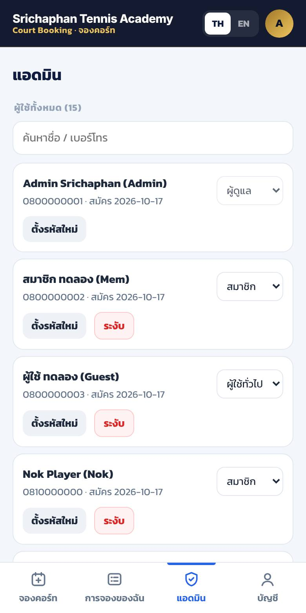

**ทาง B — ในชีท:** แท็บ **Users** → คอลัมน์ `role` → พิมพ์ `member` / `user` / `admin` (ตัวพิมพ์เล็ก สะกดให้ตรงกับแท็บ Roles)

> เพิ่มแอดมินคนที่ 2 ไว้เสมอ (เช่น ผู้จัดการสนาม) เผื่อแอดมินหลักลืมรหัส — แอดมินแก้เลเวลหรือระงับบัญชีตัวเองไม่ได้ (กันพลาด)

---

## 4. ปรับสิทธิ์แต่ละเลเวล (แท็บ Roles)

เปิด Google Sheet → แท็บ **Roles** → แก้ตัวเลขได้เลย **มีผลทันทีกับทุกคน ไม่ต้อง deploy ใหม่**
(ผู้ใช้ที่เปิดหน้าเว็บค้างไว้ กดรีเฟรชหน้าเว็บ 1 ครั้งเพื่อเห็นช่วงวันใหม่)

| คอลัมน์ | ความหมาย | ค่าตอนนี้ (admin / member / user) |
|---|---|---|
| `role` | รหัสเลเวล ใช้ในคอลัมน์ role ของ Users — **ห้ามแก้ชื่อเลเวลที่มีคนใช้อยู่** | `admin` / `member` / `user` |
| `label` | ชื่อที่แสดงในหน้าเว็บ รูปแบบ `ไทย / English` | ผู้ดูแล / สมาชิก / ผู้ใช้ทั่วไป |
| `advance_days` | **ดูตาราง + จองล่วงหน้าได้กี่วัน** นับจากวันนี้ (0 = วันนี้อย่างเดียว) | 30 / **14** / **7** |
| `max_hours_per_day` | จองได้กี่ชั่วโมงต่อวัน (รวมทุกคอร์ท) · 0 = ไม่จำกัด | 0 / 2 / 1 |
| `max_active_bookings` | มีการจองที่ยังไม่ถึงเวลาเล่นค้างได้กี่รายการ · 0 = ไม่จำกัด | 0 / 4 / 2 |
| `cancel_before_hours` | ต้องยกเลิกก่อนเวลาเล่นอย่างน้อยกี่ชั่วโมง | 0 / 3 / 6 |
| `can_book_for_others` | ใส่ชื่อคนอื่นตอนจองได้ | TRUE / FALSE / FALSE |
| `can_block` | ปิดคอร์ทได้ + เลือกดูวันไหนก็ได้ | TRUE / FALSE / FALSE |
| `can_cancel_any` | ยกเลิกการจองของทุกคน + เห็นชื่อผู้จองในตาราง | TRUE / FALSE / FALSE |
| `can_manage_users` | เห็นแท็บ "แอดมิน" จัดการผู้ใช้ | TRUE / FALSE / FALSE |

**ตัวอย่างการปรับ**

- อยากให้ผู้เล่นทั่วไปจองได้ 2 ชม./วัน → แถว `user` คอลัมน์ `max_hours_per_day` ใส่ `2`
- ผู้เล่นทั่วไปดูได้ 7 วันแต่จองค้างได้แค่ 2 รายการ — ถ้าอยากให้จองล่วงหน้าทั้งสัปดาห์ได้มากขึ้น เพิ่ม `max_active_bookings`
- **เพิ่มเลเวลใหม่** เช่น VIP ดูได้ 21 วัน → เพิ่มแถวใหม่ใต้ `user`:
  `vip` · `วีไอพี / VIP` · `21` · `3` · `6` · `2` · `FALSE` · `FALSE` · `FALSE` · `FALSE`
  แล้วไปเปลี่ยนเลเวลผู้ใช้เป็น `vip` ในหน้าแอดมิน (ดรอปดาวน์จะมีตัวเลือกใหม่ทันที)

⚠️ **ห้ามลบแถว `user`** — ระบบใช้สิทธิ์ของ `user` กับคนที่ยังไม่ล็อกอิน และกับผู้ใช้ที่ role สะกดผิด
⚠️ **ห้ามเปลี่ยนชื่อหัวคอลัมน์** (แถวที่ 1) ในทุกแท็บ — สลับลำดับคอลัมน์ได้ แต่ห้ามเปลี่ยนชื่อ

---

## 5. คู่มือผู้เล่น

> ส่วนนี้ก๊อปไปโพสต์ใน LINE OA / กลุ่มได้เลย

### สมัครและล็อกอิน

1. เปิด `https://<เว็บ>/booking.html` (หรือหน้าแรก → เมนู **Court Booking**)
2. กดไอคอนคนมุมขวาบน → แท็บ **สมัครสมาชิก**
3. กรอกเบอร์โทร, ชื่อ-นามสกุล, ชื่อเล่น (ไม่บังคับ), รหัสผ่านอย่างน้อย 6 ตัว → **สมัครสมาชิก**
4. ครั้งต่อไปใช้เบอร์ + รหัสผ่าน **เข้าสู่ระบบ** (ระบบจำการล็อกอินไว้ 30 วัน)

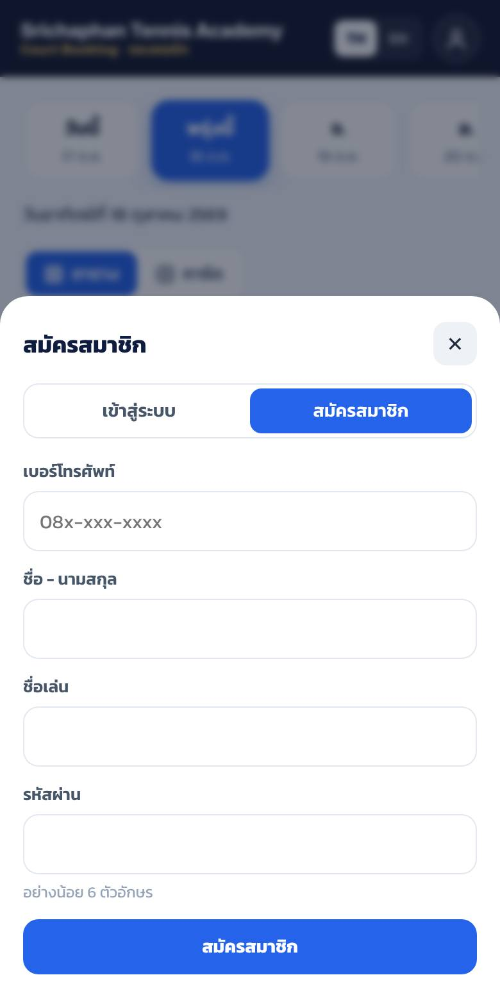 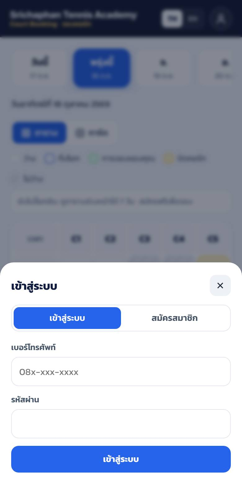

### ดูตารางสนาม

- แถบวันด้านบนเลื่อนซ้าย-ขวาได้ — **จำนวนวันที่เห็นขึ้นกับเลเวล**: ผู้เล่นทั่วไป 7 วันล่วงหน้า · สมาชิก 14 วัน
- ไม่ล็อกอินก็ดูตารางได้ (7 วัน) แต่ต้องล็อกอินก่อนจอง
- ความหมายของสี

| สี | ความหมาย |
|---|---|
| ⬜ ขาว | ว่าง จองได้ |
| 🟦 กรอบฟ้า + ✓ | ช่องที่คุณกำลังเลือก |
| 🟩 เขียว "คุณ" | การจองของคุณ |
| 🟨 เหลือง | แอดมินปิดคอร์ท (ซ่อม / คลาสเรียน / แข่ง) |
| ▨ เทาลาย 🔒 | มีคนจองแล้ว |
| เทาจาง | เวลาผ่านไปแล้ว |

- ☀️ = ช่วงกลางวัน · 🌙 = ตั้งแต่ 18:00 (ไฟสนาม)
- กด **การ์ด** เพื่อดูแบบรายชั่วโมง บอกจำนวนคอร์ทว่าง เช่น "ว่าง 3/5"

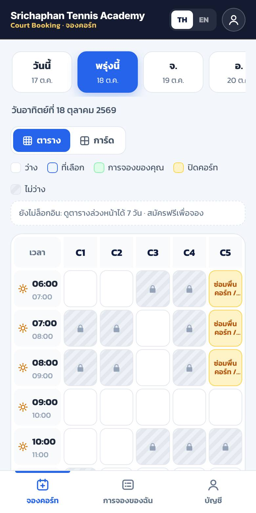 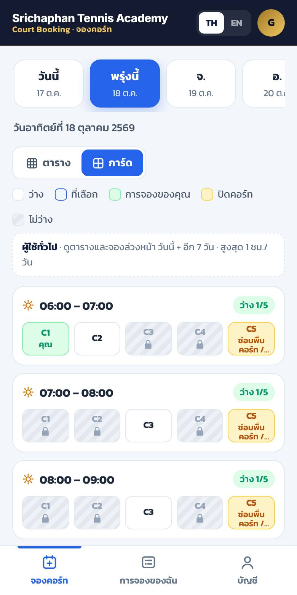

### จองคอร์ท

1. เลือกวันที่แถบด้านบน
2. แตะช่องว่างของคอร์ทและเวลาที่ต้องการ (เลือกหลายช่องได้ ตามโควต้าเลเวล) → ช่องจะขึ้น ✓
3. แถบด้านล่างขึ้น "เลือกแล้ว N ชั่วโมง" → กด **จองเลย**
4. ตรวจรายการ → กด **ยืนยัน** → ขึ้น "จองสำเร็จ 🎾" ช่องเปลี่ยนเป็นสีเขียว

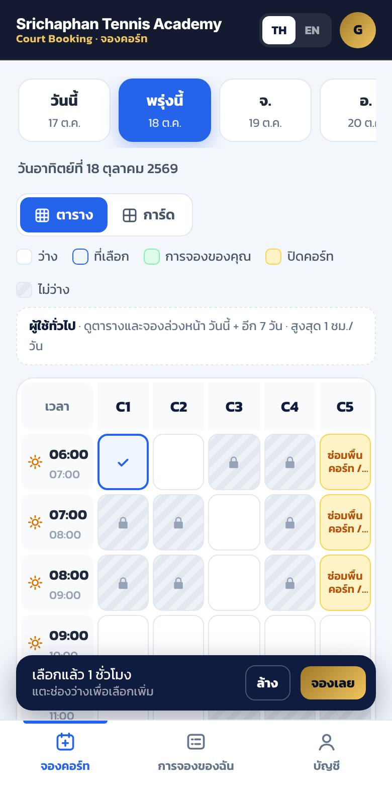 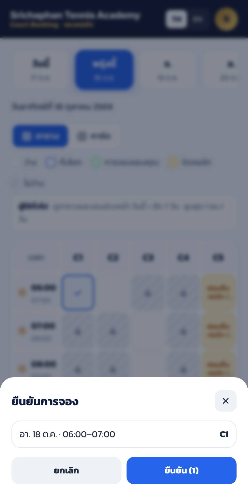

ถ้าจองไม่ได้ ระบบจะบอกเหตุผล เช่น
- "เลเวลของคุณดูตารางและจองล่วงหน้าได้ไม่เกิน 7 วัน"
- "สิทธิ์ของคุณจองได้สูงสุด 1 ชม. ต่อวัน"
- "C2 เวลา 18:00 มีคนจองไปแล้ว" (มีคนกดก่อนไม่กี่วินาที — ตารางจะรีเฟรชให้)

### ดูและยกเลิกการจอง

- แท็บ **การจองของฉัน** → เห็นรายการที่กำลังจะมาถึง และประวัติ
- กด **ยกเลิก** ได้ถ้ายังอยู่ในเวลาที่กำหนด (ผู้เล่นทั่วไป: ก่อนเล่น 6 ชม. · สมาชิก: 3 ชม.)
- หรือแตะช่องสีเขียวในตาราง → **ยกเลิกการจองนี้**
- เลยเวลายกเลิกแล้ว → ติดต่อแอดมิน

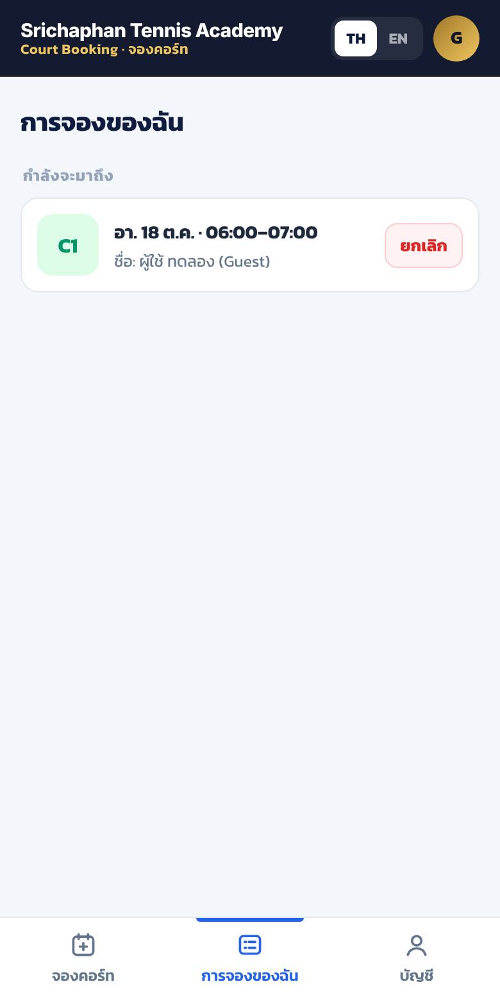 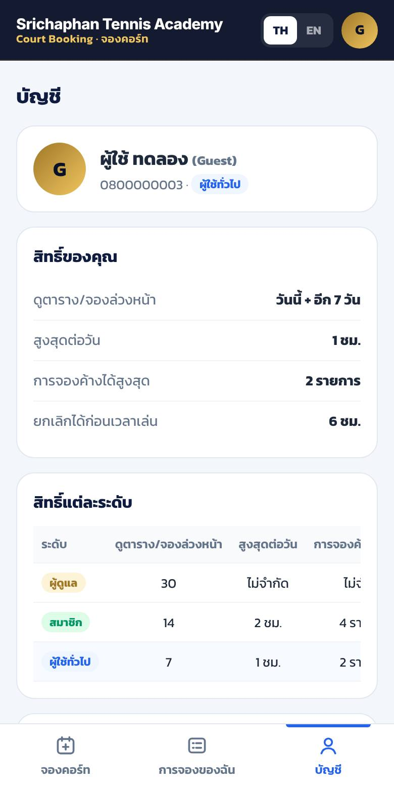

### บัญชี

แท็บ **บัญชี** → ดูเลเวลและสิทธิ์ของตัวเอง, ตารางเปรียบเทียบสิทธิ์ทุกเลเวล, **เปลี่ยนรหัสผ่าน**, **ออกจากระบบ**
ปุ่ม **TH / EN** มุมขวาบนสลับภาษา
**ลืมรหัสผ่าน** → ทักแอดมินทาง LINE OA ให้ตั้งรหัสใหม่ให้

---

## 6. คู่มือแอดมิน

แอดมินเห็นทุกอย่างเหมือนผู้เล่น บวกกับ
- แถบวัน **30 วัน** + ช่อง **วันอื่น** เลือกวันไหนก็ได้ (ล่วงหน้าถึง 1 ปี)
- ตารางแสดง **ชื่อผู้จองทุกช่อง**
- แท็บ **แอดมิน** ที่แถบล่าง

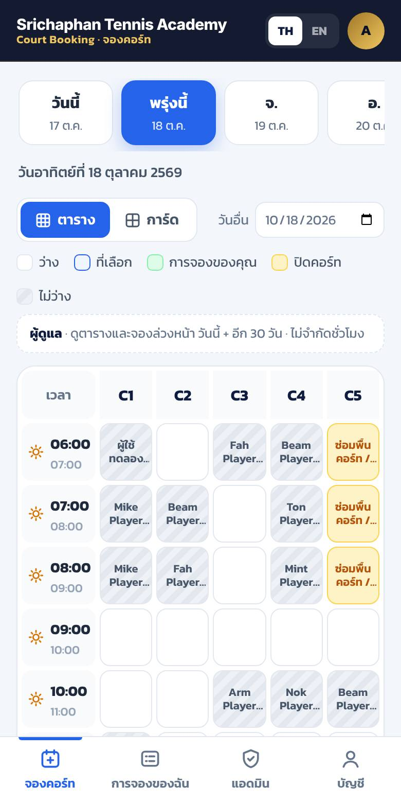

### จองให้ผู้เล่น (เช่น ลูกค้าโทรมาจอง / จองให้โค้ช)

1. เลือกช่อง → **จองเลย**
2. ช่อง **จองให้ (ชื่อผู้เล่น)** ใส่ชื่อ เช่น `คุณสมชาย (โทรจอง)` — เว้นว่าง = จองในชื่อแอดมิน
3. **หมายเหตุ** (ไม่บังคับ) เช่น เบอร์ติดต่อ / จ่ายแล้ว → **ยืนยัน**

> การจองที่แอดมินจองให้ ไม่นับโควต้าของผู้เล่นคนนั้น และจะอยู่ใน "การจองของฉัน" ของแอดมิน

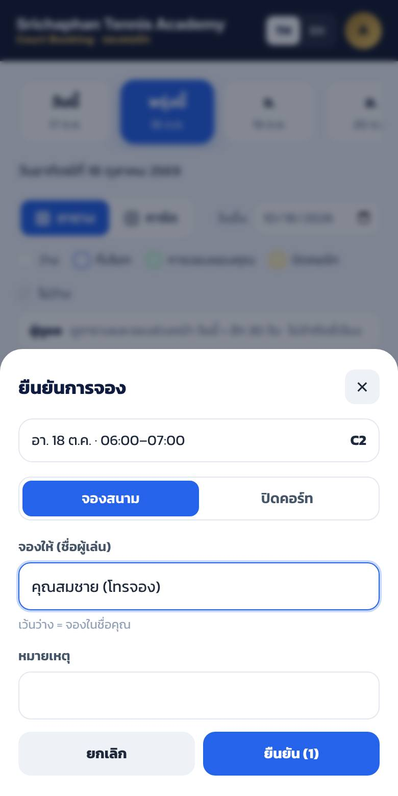

### ปิดคอร์ท (ซ่อม / คลาสเรียน / จัดแข่ง)

1. เลือกช่องที่จะปิด (หลายคอร์ทหลายชั่วโมงได้ ครั้งละไม่เกิน 20 ช่อง)
2. **จองเลย** → เลือก **ปิดคอร์ท** → ใส่ **เหตุผลที่ปิด** (บังคับ — ผู้เล่นจะเห็นข้อความนี้ในช่องสีเหลือง)
3. **ยืนยัน** → ขึ้น "ปิดคอร์ทแล้ว N ช่อง"
4. จะปิดวันไกล ๆ (เช่น วันแข่งเดือนหน้า) ใช้ช่อง **วันอื่น** เลือกวัน

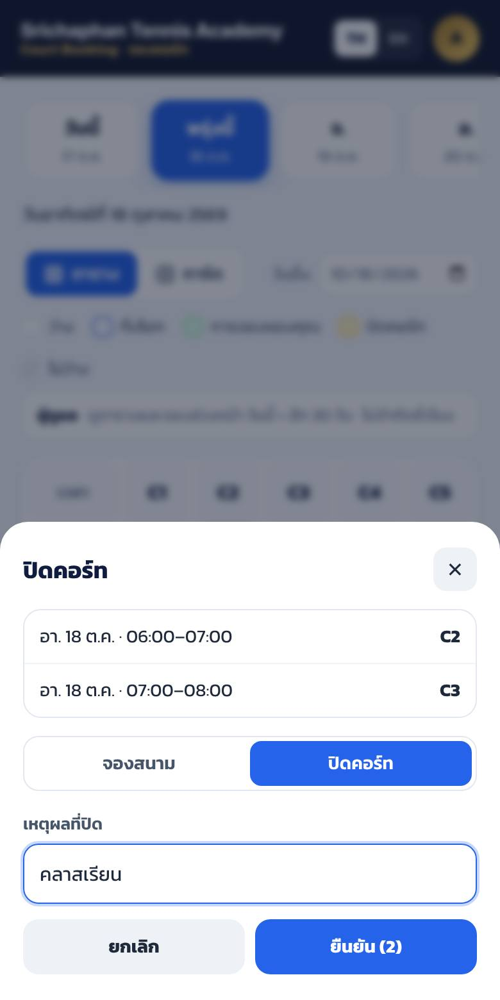

### ยกเลิกการจองของผู้เล่น / เปิดคอร์ทคืน

แตะช่องที่มีชื่อ (หรือช่องเหลือง) → ดูรายละเอียด → **ยกเลิกการจองนี้** / **เปิดคอร์ท (ยกเลิกการปิด)**
แอดมินยกเลิกได้ตลอด ไม่ติดกฎเวลา

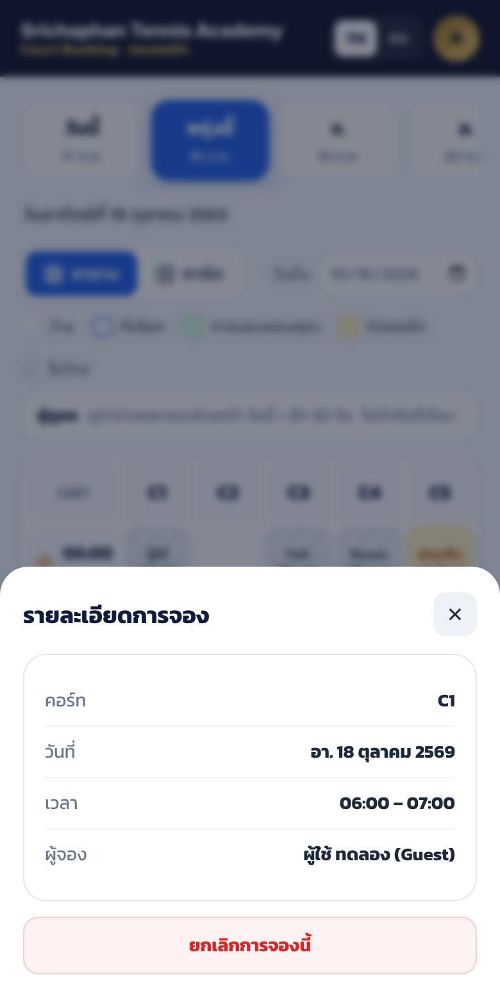

### จัดการผู้ใช้ (แท็บ แอดมิน)

| ทำอะไร | วิธี |
|---|---|
| เปลี่ยนเลเวล | ดรอปดาวน์ด้านขวาของชื่อ → เลือกเลเวล |
| ผู้ใช้ลืมรหัส | **ตั้งรหัสใหม่** → พิมพ์รหัสใหม่ (≥ 6 ตัว) → แจ้งผู้ใช้ทาง LINE ให้ไปเปลี่ยนเองในแท็บบัญชี |
| ระงับบัญชี (เช่น จองแล้วไม่มาบ่อย) | **ระงับ** → ล็อกอินไม่ได้ทันที การจองเดิมยังอยู่ (ยกเลิกเองถ้าต้องการ) |
| เปิดบัญชีคืน | **เปิดใช้** |

ด้านล่างของแท็บแอดมินมีตารางสิทธิ์ทุกเลเวล (แก้ในแท็บ Roles ของชีท — ส่วนที่ 4)

### ดูข้อมูลการจองในชีท

แท็บ **Bookings** มีทุกการจอง ใช้ **Data → Create a filter** กรองตามวันที่ (`date`) / คอร์ท / สถานะได้
- อยากยกเลิกจากชีท → แก้ `status` เป็น `cancelled` (**อย่าลบแถว**)
- อย่าแก้ `date`, `hour`, `court` ของการจองโดยตรง (อาจชนกับการจองอื่นโดยระบบไม่รู้) — ให้ยกเลิกแล้วจองใหม่ในหน้าเว็บ

---

## 7. แก้ค่าในโค้ด และการ deploy เวอร์ชันใหม่

ค่าที่แก้ได้อยู่ในบล็อก **"แก้ตรงนี้ได้"** ด้านบนสุดของ `WOOPS_Court_Booking.gs`

| ค่า | คุมอะไร | ตอนนี้ |
|---|---|---|
| `COURTS` | ชื่อ/จำนวนคอร์ท (หน้าเว็บดึงจากหลังบ้านอัตโนมัติ) | `['C1','C2','C3','C4','C5']` |
| `OPEN_HOUR` / `CLOSE_HOUR` | เวลาเปิด–ปิด | `6` / `23` (ช่องแรก 06:00 ช่องสุดท้าย 22:00–23:00) |
| `NIGHT_FROM_HOUR` | ตั้งแต่ชั่วโมงไหนแสดง 🌙 | `18` |
| `SESSION_DAYS` | ล็อกอินค้างได้กี่วัน | `30` |
| `MAX_BLOCK_DAYS_AHEAD` | แอดมินปิดคอร์ทล่วงหน้าไกลสุดกี่วัน | `365` |

> สิทธิ์ของเลเวล (14 วัน / 7 วัน ฯลฯ) **ไม่ต้องแก้ในโค้ด** — แก้ในแท็บ Roles (ส่วนที่ 4)

### ⚠️ แก้โค้ดแล้วต้อง deploy เวอร์ชันใหม่

แก้ `.gs` แล้วกด Save อย่างเดียว **เว็บจริงยังใช้โค้ดเก่า** ต้องทำต่อ:

1. **Deploy → Manage deployments**
2. เลือก deployment ที่ใช้อยู่ → กดไอคอนดินสอ ✏️ **Edit**
3. ช่อง **Version** เลือก **New version** → **Deploy**
4. URL เดิมใช้ต่อได้ ไม่ต้องแก้ `booking.html`

❌ อย่ากด **New deployment** — จะได้ URL ใหม่ ต้องกลับไปแก้ `API_URL` ใน `booking.html` ใหม่ด้วย

### อัปเดตจากเวอร์ชันเก่า

ถ้าเคยติดตั้งเวอร์ชันแรก (สมาชิก 7 วัน / ผู้เล่นทั่วไป 1 วัน) แท็บ Roles จะยังเป็นค่าเก่า
เพราะ `setup` ไม่เขียนทับแท็บที่มีอยู่แล้ว → แก้ในแท็บ **Roles**: แถว `member` คอลัมน์ `advance_days` = `14`,
แถว `user` = `7` แล้ววางโค้ด `.gs` ใหม่ทับ + deploy New version ตามขั้นตอนด้านบน

---

## 8. เช็คลิสต์ก่อนเปิดใช้จริง

- [ ] รัน `setup` แล้วเห็นแท็บ Users / Bookings / Roles ครบ
- [ ] แท็บ Roles: `member` advance_days = 14 · `user` = 7 (และค่าอื่นตรงกับกติกาสนาม)
- [ ] Deploy เป็น Web app: **Execute as: Me** + **Who has access: Anyone**
- [ ] เปิด Web app URL แล้วเห็น `{"ok":true,...}`
- [ ] ใส่ `API_URL` ใน `booking.html` แล้วขึ้นเว็บจริง — **แถบเหลือง "โหมดทดลอง" หายไป**
- [ ] สมัครบัญชีแอดมินตัวเองเป็นคนแรก → แท็บ Users แถวแรก role = `admin`
- [ ] เพิ่มแอดมินสำรองอีก 1 คน
- [ ] ทดสอบด้วยมือถือ 2 เครื่อง
  - [ ] เครื่อง A สมัครผู้เล่นใหม่ → แถบวันเห็น **8 วัน** (วันนี้ + 7)
  - [ ] แอดมินเปลี่ยนเครื่อง A เป็นสมาชิก → เครื่อง A รีเฟรช → เห็น **15 วัน** (วันนี้ + 14)
  - [ ] เครื่อง A จองช่องหนึ่ง → เครื่อง B (ไม่ล็อกอิน) รีเฟรช ต้องเห็นช่องนั้นเป็น 🔒
  - [ ] ผู้เล่นทั่วไปลองจอง 2 ชม. ในวันเดียว → ต้องขึ้นข้อความเตือน
  - [ ] ยกเลิกการจอง → แท็บ Bookings แถวนั้น status = `cancelled`
- [ ] แอดมินลองปิดคอร์ท 1 ช่อง แล้วเปิดคืน
- [ ] โพสต์ประกาศให้ผู้เล่น (ใช้ส่วนที่ 5)

---

## 9. ถ้าเจอปัญหา

| อาการ | สาเหตุ / วิธีแก้ |
|---|---|
| หน้าเว็บขึ้น "เชื่อมต่อไม่ได้" | `API_URL` ผิด (ต้องลงท้าย `/exec`) หรือ deployment ไม่ใช่ *Anyone* → แก้ที่ Manage deployments |
| ยังเห็นแถบเหลือง "โหมดทดลอง" | `API_URL` ยังว่าง หรือไฟล์บนเว็บยังเป็นเวอร์ชันเก่า → เช็คว่า commit ขึ้น branch ที่เว็บใช้ + กด Ctrl+Shift+R |
| error "ยังไม่ได้รัน setup()" | รัน `setup` ใน Apps Script (รันซ้ำได้ ไม่ลบข้อมูล) |
| แก้โค้ด .gs แล้วไม่เปลี่ยน | ยังไม่ได้ deploy **New version** (ส่วนที่ 7) |
| แก้ Roles แล้วหน้าเว็บยังเห็นวันเท่าเดิม | ผู้ใช้ต้องรีเฟรชหน้าเว็บ 1 ครั้ง · เช็คว่าสะกด role ตรงกันทั้งแท็บ Users และ Roles |
| ผู้เล่นบอก "ดูวันที่ 10 ไม่ได้" | เป็นไปตามเลเวล (ทั่วไป 7 วัน / สมาชิก 14 วัน) → เลื่อนเลเวลในแท็บแอดมินถ้าสมควร |
| "ระบบกำลังยุ่ง ลองใหม่อีกครั้ง" | มีคนจองพร้อมกันเยอะมากในวินาทีเดียว (เช่น เปิดจองพร้อมกันตอน 00:00) → กดใหม่อีกครั้ง |
| ผู้ใช้ลืมรหัสผ่าน | แอดมิน → แท็บแอดมิน → **ตั้งรหัสใหม่** |
| แอดมินลืมรหัสตัวเอง | ใช้แอดมินสำรองตั้งให้ · ถ้าไม่มี: ในชีทแท็บ Users เปลี่ยน role ของบัญชีอื่นที่คุณใช้ได้เป็น `admin` |
| เบอร์ในชีทหาย 0 ข้างหน้า | ไม่เป็นไร ระบบเติม 0 ให้เองตอนอ่าน |
| ระบบเริ่มช้า (Bookings หลักหมื่นแถว) | ก๊อปแถวเก่าที่เลยวันเล่นไปแล้วไปเก็บชีทอื่น แล้วลบออกจาก Bookings (เก็บแถวหัวไว้ · อย่าย้ายการจองที่ยังไม่ถึงวัน) |
| หน้าขาว / error แปลก ๆ ตอน Run ใน Apps Script | เลือกฟังก์ชันผิด → เลือก `setup` |

---

## 10. ภาคผนวก: คอลัมน์ในชีท

**Users**

| คอลัมน์ | ความหมาย | แก้มือได้? |
|---|---|---|
| `id` | รหัสผู้ใช้ (ระบบสร้าง) | ❌ |
| `phone` | เบอร์โทร ใช้ล็อกอิน | ⚠️ ได้ ถ้าผู้ใช้เปลี่ยนเบอร์ (ห้ามซ้ำกับคนอื่น) |
| `name`, `nickname` | ชื่อ / ชื่อเล่น | ✅ |
| `role` | เลเวล — ต้องตรงกับแท็บ Roles | ✅ |
| `status` | `active` / `suspended` | ✅ |
| `salt`, `password_hash` | รหัสผ่านแบบเข้ารหัส (ไม่มีใครอ่านรหัสจริงได้) | ❌ ห้ามแตะ |
| `created_at` | วันที่สมัคร | ❌ |

**Bookings**

| คอลัมน์ | ความหมาย |
|---|---|
| `id` | รหัสการจอง |
| `date`, `hour`, `court` | วันที่ (`2026-10-18`), ชั่วโมงเริ่ม (`18` = 18:00–19:00), คอร์ท |
| `user_id`, `name` | ใครเป็นคนกดจอง / ชื่อที่แสดง (แอดมินจองให้คนอื่น = ชื่อที่ใส่) |
| `type` | `booking` = จองเล่น · `block` = แอดมินปิดคอร์ท |
| `note` | หมายเหตุ / เหตุผลที่ปิด |
| `status` | `active` / `cancelled` |
| `created_at`, `created_by` | จองเมื่อไหร่ โดยใคร |
| `cancelled_at`, `cancelled_by` | ยกเลิกเมื่อไหร่ โดยใคร |

**Roles** — ดูส่วนที่ 4

---

## ข้อจำกัดที่ควรรู้

- ยังไม่มีระบบชำระเงิน / OTP / อีเมลยืนยัน — ล็อกอินด้วยเบอร์โทร + รหัสผ่าน (ไม่ได้ยืนยันว่าเป็นเบอร์จริงของคนนั้น)
- Apps Script ตอบช้ากว่าเว็บทั่วไปเล็กน้อย (~1–2 วินาทีต่อคำสั่ง)
- ตารางรีเฟรชเองทุก 60 วินาที — ถ้าอยากเห็นล่าสุดทันที กดเลือกวันใหม่หรือรีเฟรชหน้า
- โควต้าฟรีของ Google Apps Script เพียงพอสำหรับสโมสรขนาดนี้ (หลักพันคำสั่งต่อวันสบาย ๆ)
